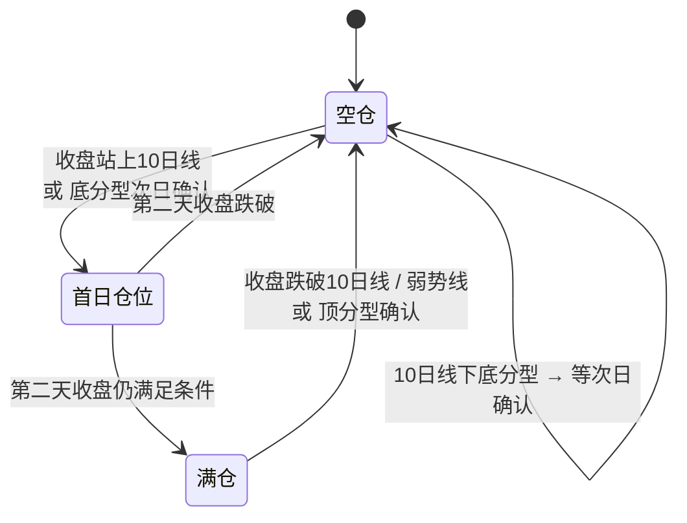

# 突破策略说明（实盘版）

> **这份文档只写"现在实盘怎么做"**。每次实盘规则有变化：先改代码，再改本文对应章节，并在下面「变更记录」加一行。
> 项目结构、文件说明、回测过程见 [项目交接.md](项目交接.md)。
>
> 当前版本：**2026-11-05**

## 变更记录（新的在上）

| 日期 | 变更 | 依据 |
|---|---|---|
| 2026-11-05 | **周五也正常开新仓**（周线票用上周信号，周一~五都有效）；周四收盘照常出股票池 | 合并池年化 23.6% → 24.9%、回撤 −19.4% → −18.0%；注意 18-24 更好（+4）、24-26 更差（−7）（`backtest/backtest_friday.py`） |
| 2026-11-04 | 券商网格用「按价格」（每格都相对买入价，价差 = 买入价 × 步长）；持仓 csv 加「网格价差」「剩余网格卖出价」 | 按价格 23.6% vs 按比例（逐格复利）22.6% |
| 2026-11-04 | 网格步长统一用**买入前一交易日**的 ATR14% × 1.2（原来周线票用信号周五的） | 回测几乎无差别（合并池 23.6% / −19.4%），口径更直观 |
| 2026-11-04 | 1 层参考股数改按前收 × 1.04 估算（挂单上限仍是 1.07） | 按 1.07 算会少买太多 |
| 2026-11-04 | 首日建仓：开仓信号当天深证综指涨 > 3% 时建 70%，否则 40% | 合并池年化 22.6% → 23.6%，回撤不变（`backtest/backtest_first_level.py strong`） |
| 2026-11-04 | 新浪日 K 没出今天的数据就等待（每 5 分钟查一次，最多 90 分钟） | 实测新浪个股 ~15:30、指数 ~15:36 才更新 |
| 2026-11-04 | 全市场改用前复权价（新浪复权因子），与回测同口径；排除北交所 | 原来日线选股用不复权价，除权票会漏选 |
| 2026-11-04 | 周线票的 RPS120 / 10 日排名固定取信号周五的值（周中不重算） | 与回测、前向跟踪统一（`backtest/backtest_rank_refresh.py`） |
| 2026-11-04 | 排序：RPS120 同分（一位小数）时 10 日涨幅弱→强 | 顺序固定；回测略好（`backtest/backtest_priority.py`） |
| 2026-11-03 | 大盘指数改为深证综指（399106） | 与博主一致；年化比深证成指高约 3 个点 |
| 2026-11-03 | 确认合并池方案：周线（W2/W3/买点2）+ 日线（连续 ≥ 2 日新高），RPS120 排序，开盘 > 7% 不买，止损资金冻结到周一，T+1 | 长周期回测（`backtest/backtest_long_run.py`） |

---

## 一、一页速览

| 环节 | 规则 |
|---|---|
| **大盘** | 深证综指 10 日线 + 顶 / 底分型，只看收盘。首日建 40%（当天涨 > 3% 建 70%），第二天满足条件加满 100%；跌破就次日开盘清仓 |
| **选股** | 周线：买点1-W2、买点1-W3、买点2（每周五出信号，下周一~五有效） 日线：100 日新高且连续 ≥ 2 日、放量、K 线健康（只在次日有效） |
| **排序** | RPS120 高→低（一位小数），同分时 10 日涨幅弱→强 |
| **买入** | 集合竞价挂前收 × 1.07，开盘涨幅 > 7% 买不到就算了；每只 1 层（总资产 10%）；周一~周五都可开新仓 |
| **卖出** | ① 止损：盘中跌破 max(昨日 MA5, 昨日最低) × 0.99 ② 走弱：买入当天和第 2 个交易日，不创新高或不收涨（当天触发→次日开盘卖；第 2 天→尾盘卖） ③ 网格止盈：每涨 1.2 × ATR 卖 1/4 ④ 大盘清仓 |
| **资金** | 止损 / 走弱卖出的钱冻结到下周一；网格卖出的钱次日可用；同一只票本周卖了不再买 |
| **回测** | 2018-10 ~ 2026-11 年化 23.6%、最大回撤 −19.4%；**实际预期按年化 12% ~ 20%、回撤 20% ~ 25% 看** |

---

## 二、每天怎么操作

程序每天收盘后自动跑（服务器周一~四 15:30、周五 19:00），发「操作建议」邮件，附件两个 csv：
- `pool_下一交易日.csv`：股票池（买什么、按什么顺序、挂什么价、买多少股）；
- `forward_holdings_今天.csv`：持仓（每只明天的盘中清仓价、要不要开盘卖）。

| 时间 | 做什么 | 看哪里 |
|---|---|---|
| **9:15 ~ 9:25 集合竞价** | ① 邮件写"集合竞价全部清仓" → 全部卖出 ② 持仓 csv「下一日操作 = 开盘卖出」的 → 卖出 ③ 买入：按股票池「买入顺序」，价格挂「开盘买入价上限」，数量用「1 层参考股数」，买够「最多新开 N 只」为止；「备注」有内容的跳过 | 邮件正文、两个 csv |
| **买入当天收盘后** | 设券商网格条件单，选 **「按价格」**：基准 = 成交价，价差 = 持仓 csv「网格价差」（= 买入价 × 网格步长%），**只卖不买**，4 份。设好后不再改。若实际成交价和 csv 的买入价不同，价差按实际成交价 × 步长重算 | 持仓 csv |
| **买入次日开盘** | 买入当天已涨过第 1 格的（T+1 当天卖不了）：开盘手动卖 1 份；剩下的仍按原价位（csv「剩余网格卖出价」）挂，不重新以卖出价为基准 | 持仓 csv |
| **开盘后** | 每只持仓挂盘中清仓条件单，价格 = 持仓 csv「下一日盘中清仓价」，**每天更新一次** | 持仓 csv |
| **14:55 尾盘** | 买入后的第 2 个交易日：当日最高 ≤ 昨日最高，或现价 ≤ 昨日收盘 → 卖出（买入当天走弱的不用管，T+1 卖不了，程序收盘后会标「开盘卖出」，次日集合竞价卖） | 盘面 |
| **收盘后** | 在 `stock_result/actual_account.csv` 追加一行 `日期,总资产`（可选，用于和模拟对比） | — |

> 股票池里「1 层参考股数」按前收 × 1.04 算。开盘涨幅在 4% ~ 7% 之间时，实际金额会略超 1 层（最多约 3%），资金不够就少买一手。

---

## 三、大盘仓位（深证综指 399106）

**只看收盘，不看盘中**。每天收盘算出"下一交易日开盘的目标仓位"。仓位以层计：1 层 = 10%。

### 3.1 分型

相邻 3 根日 K，不做包含处理，第 3 根收盘时确认：
- **底分型**：中间那根的最高价、最低价都低于左右两根。
- **顶分型**：中间那根的最高价、最低价都高于左右两根。

### 3.2 规则

| 场景 | 条件（看收盘） | 下一交易日开盘 |
|---|---|---|
| **站上 10 日线** | 空仓时收盘 ≥ MA10 | 建 **40%**（当天指数涨 > 3% 则 **70%**） |
| | 第二天收盘仍 ≥ MA10 | 加满 **100%** |
| **跌破 10 日线** | 收盘 < MA10 | 当天停止新开 / 加仓，**次日集合竞价清仓** |
| **10 日线下底分型** | 第 3 根收盘时出现底分型，弱势线 = 第 3 根收盘价 | 先不动，等确认 |
| | 次日收盘 ≥ 弱势线（确认） | 建 **40%**（确认当天指数涨 > 3% 则 **70%**） |
| | 次日收盘 < 弱势线 | 底分型作废，继续空仓 |
| | 建仓后收盘 ≥ 弱势线 | 加满 **100%** |
| | 建仓后收盘 < 弱势线 | 清仓 |
| | 持仓中又出新底分型 | 弱势线上移到新的第 3 根收盘 |
| | 收盘站上 10 日线 | 改按 10 日线规则 |
| **顶分型**（有仓位时） | 出现后次日收盘 > 第 3 根收盘 | 顶分型失效，继续持有 |
| | 次日收盘 ≤ 第 3 根收盘 | **第三日开盘清仓** |
| | 清仓后 | 收盘突破顶点（中间那根最高价）且在 10 日线上才重新按 10 日线建仓；先跌破 10 日线则回到空仓逻辑 |

- 邮件里每天写清楚：当前仓位、下一日仓位和操作、原因、**下一日收盘要看的价位**。
- 盘中跑（未收盘）会额外给一行"若按当前价收盘"的预估，仅供参考。
- 参数：`stock_check_xinlang.py` 的 `MARKET_INDEX`、`FIRST_LV = 0.4`、`STRONG_UP_PCT = 0.03`、`STRONG_UP_LV = 0.7`。

---

## 四、选股

范围：沪深 A 股，**不含北交所、ST**。所有价格都是前复权。

### 4.1 周线信号（`stock_screener.py`，每周五 19:00 跑一次）

只用三类：**买点1-W2、买点1-W3、买点2**。周五收盘出信号，**下周一到周五**有效。

**通用过滤**（不满足直接排除）

| 条件 | 阈值 |
|---|---|
| 股价 | ≥ 3 元 |
| 近 4 周平均周换手率 | ≥ 0.5% |
| 流通市值（估算） | ≥ 20 亿 |
| 本周涨幅 | < 30% |
| 本周放量且上影 ≥ 实体 | 排除 |
| 连续收红周数 | < 10 周 |
| 历史（近 3 年）最大单周涨幅 | ≥ 15% |
| 历史周数 | ≥ 40 周 |

**买点1：放量突破 + 确认**

| 周 | 条件 |
|---|---|
| **W1 力度周** | 收盘 > 前 20 周最高收盘；收盘 > MA20；MA20 走平或向上；周涨幅 ≥ 5%；成交额 ≥ 上周 × 1.6 |
| **W2 确认周** | 收盘 > W1 收盘；收红；相对 W1 涨幅 < 15%；成交额 ≤ W1 × 1.5 |
| 信号 | 本周就是 W2 → **买点1-W2**；W2 是上周、本周是 W3 → **买点1-W3**（本周不额外要求） |
| 突破价 | W1 收盘价 |

**买点2：回踩反包**

| 条件 | 内容 |
|---|---|
| 本周 | 收盘 > 前 20 周最高收盘（反包新高）；收红；MA5 走平或向上 |
| 突破周 | 前 5 周内最近一次创 20 周新高的那周；它的前一周收红 |
| 量能 | 本周成交额 ≤ 突破周 × 1.5 |
| 回踩周（突破周和本周之间） | 1 ~ 4 周；每周收盘都低于突破周和本周收盘 |
| 回踩 1~2 周 | 成交额 < 突破周；收盘 ≥ MA5 × 0.98 |
| 回踩 3~4 周 | 成交额 < 突破周 × 1.3；收盘 ≥ MA20 × 0.98 |
| 突破价 | 突破周收盘价 |

**不用的**：买点1-W1（还没确认）、买点3（W1 成交额 ≥ 3 倍，回测 2018~2024 拖累收益）。

### 4.2 日线信号（`screen_new_high_breakout_sina`，每天收盘后）

全部满足才入选，**只在下一交易日开盘有效**：

| # | 条件 |
|---|---|
| 1 | 收盘 ≥ 前 100 个交易日（不含当天）最高价 |
| 2 | **连续 ≥ 2 日新高**（今天、昨天都满足 1） |
| 3 | 近 2 日涨幅 < 20%（今天收盘对比 3 个交易日前收盘） |
| 4 | 收盘 > 开盘 × 1.01 |
| 5 | 当日涨幅 > 1%；收在 (最高 + 最低) / 2 以上；上影 < 实体 |
| 6 | 成交额 ≥ 前 5 日均值 × 1.5 |
| 突破价 | 当天收盘价 |

> 2026-11-04 逐项回测过：删任何一条都变差，加市值 / 换手 / 250 日新高 / RPS 门槛等也都没有稳定改善（`backtest/backtest_daily_conditions.py`）。

---

## 五、股票池与买入

**候选** = 本周有效的周线信号 + 前一交易日的日线信号（同一只只算一次）。

**排序**：
1. RPS120 高→低（一位小数）。RPS120 = 120 日涨幅在全市场的百分位。
2. RPS120 相同时，10 日涨幅排名数字大的在前（弱→强）。
3. 取值日：周线票固定用信号周五的收盘（下周一~五不变），日线票用信号日收盘。

**剔除**（股票池「备注」列会写原因）：
- 周线票：前一日收盘 < 突破价（周中走坏）；
- 已持有；本周已买过又卖掉；
- 停牌、ST；
- 1 层买不起一手。

**买入**：
- 集合竞价挂「开盘买入价上限」= 前收 × 1.07（不超过涨停价）。开盘涨幅 > 7% 或开盘涨停就买不到，不追。
- 每只 **1 层** = 前一交易日收盘时总资产（持仓 + 现金 + 冻结资金）的 10%，整手（科创板 ≥ 200 股）。
- 可买只数取最小值：大盘目标层数 − 已持有层数；可用资金能买几层；候选数。
- **大盘清仓日不开新仓**（周五照常开，2026-11-05 起）。

---

## 六、持仓与卖出

| 规则 | 内容 |
|---|---|
| **T+1** | 买入当天不能卖。当天盘中触及止损或尾盘走弱 → 次日集合竞价卖出；当天碰到网格价不成交 |
| **止损（每天更新）** | 清仓价 = max(昨日 MA5 × 0.99, 昨日最低 × 0.99)。盘中触及就全部卖出；开盘就低于它则开盘卖 |
| **新开票走弱** | 判断条件：当日最高 > 昨日最高 **且** 收盘 > 昨日收盘，少一项就算走弱。判断两次： ① **买入当天**收盘：走弱 → T+1 卖不了，**次日集合竞价卖出**（持仓 csv「下一日操作 = 开盘卖出」） ② **买入后第 2 个交易日**尾盘：走弱 → **当天尾盘卖出** 第 3 天起不再判断，只看止损和网格 |
| **网格止盈（买入时定好）** | 步长 = **买入前一交易日**的 14 日 ATR% × 1.2；卖出价 = 买入价 × (1 + k × 步长)，k = 1~4（券商「按价格」，等差），每格卖 1/4（整手）；只卖不买；之后不改。例：买入 10、步长 6% → 10.60 / 11.20 / 11.80 / 12.40 |
| **大盘清仓** | 次日集合竞价全部卖出（不冻结资金） |
| **跌停 / 停牌** | 卖不出的顺延到下一交易日开盘 |

持仓 csv 每列的含义：
- `网格步长%`：**买入前一交易日**的 ATR14% × 1.2（股票池里给的就是这个值），买入时定下，之后每天输出都不变。
- `网格价差`：买入价 × 网格步长%，券商「按价格」网格填这个。
- `剩余网格卖出价`：还没卖的各格价位（如 `11.20/11.80/12.40`）。
- `下一日盘中清仓价`：**每天按最新收盘重新算**，条件单每天改。
- `下一日操作`：「开盘卖出」（T+1 顺延或跌停顺延）或「按清仓价挂盘中清仓条件单」。

---

## 七、资金规则

| 资金来源 | 什么时候能用来开新仓 |
|---|---|
| 网格卖出 | 下一交易日 |
| 止损 / 走弱卖出 | **冻结到下周一** |
| 大盘清仓卖出 | 立即（下次开仓时） |
| 闲置现金 | 随时 |

另外：同一只票本周买过又卖掉，本周内不再买。

---

## 八、回测表现

数据：baostock 前复权日线，2018-10 ~ 2026-11，5469 只（含退市股），实盘约束（80 万整手、实测费率、T+1、涨停买不到、跌停卖不出、止损滑点 0.2%、尾盘滑点 0.1%）。

| | 年化 | 最大回撤 | 夏普 | 2018-10 ~ 2024-07 | 2024-08 ~ 2026-11 |
|---|---|---|---|---|---|
| **实盘方案** | **23.6%** | **−19.4%** | **1.51** | 14.8% | 49.7% |
| 只用周线信号 | 16.2% | −20.8% | 1.13 | 10.1% | 33.8% |
| 只用日线信号 | 9.6% | −15.1% | 0.87 | 5.0% | 22.6% |
| 不做大盘择时 | 4.2% | −39.6% | 0.31 | 0.2% | 15.6% |
| 深证综指持有 | 6.2% | −44.1% | 0.38 | — | — |

| 年份 | 2019 | 2020 | 2021 | 2022 | 2023 | 2024 | 2025 | 2026（到 11-02） |
|---|---|---|---|---|---|---|---|---|
| 策略 | +25.9% | +38.1% | **−11.9%** | +16.9% | +31.8% | +28.2% | +50.6% | +21.0% |
| 深证综指 | +35.9% | +35.2% | +8.6% | −21.9% | −7.0% | +6.5% | +29.3% | −17.1% |

**要清楚的几点**：
- 规则是在历史数据上反复比较挑出来的，实盘大概率不如回测。**按年化 12% ~ 20%、回撤 20% ~ 25% 预期**。
- 每笔平均只赚 0.7% 左右，**成交价偏差很伤收益**：买入一定走集合竞价，止损用条件单。
- 弱点：震荡市反复被打脸（2021 年 −12%）；急涨行情跟不上（10 日线确认前已经涨完）。

**试过但没采用的改动**（详见 [项目交接.md](项目交接.md) 的研究记录）：周线参数调回 PDF 原版 / 放宽（倍量 1.5 等）、开仓头几天优先底部倍量票、走弱改尾盘卖、顶分型降仓、买入日止损豁免、过滤小步长、周中每天收盘都在突破价上才留池、辨识度分档排序、10 日涨幅排序、底分型确认加严、首日一律 5~8 层、加入北交所、近 2 日涨幅放宽、日线新增各类过滤。
