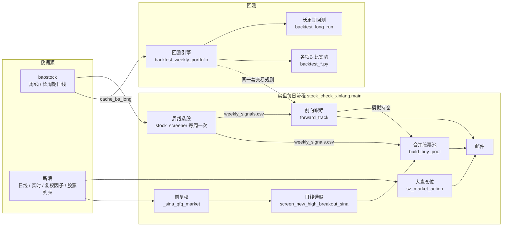

# stock 项目交接文档

> 策略规则本身见 [策略说明.md](策略说明.md)（实盘规则以它为准）。本文讲：项目做了什么、代码怎么组织、怎么运行和部署、做过哪些研究。
>
> 更新：2026-11-04

## 一、项目做什么

一套 **A 股突破选股 + 大盘择时** 的半自动交易辅助系统。策略来自公众号博主「一戈168」，在他的规则基础上用长周期回测逐项验证、调整。

每个交易日收盘后，服务器自动：
1. 按深证综指判断**明天的目标仓位**（0% / 40% / 70% / 100%）；
2. 选出**明天可买的股票**并排好顺序（周线信号 + 日线信号合并池）；
3. 按实盘规则**模拟账户**（前向跟踪），算出每只持仓明天的止损价；
4. 发邮件「操作建议」。

人工根据邮件在券商端下单（集合竞价买卖、网格、条件单）。程序不连券商、不自动下单。

## 二、整体结构



**关键设计**：实盘的大盘判断（`_sz_market_states`）和回测（`market_levels_v2`）逐日对齐（2189 天 0 差异）；前向跟踪直接调用回测引擎的 `run_portfolio`，所以"回测怎么做 = 模拟账户怎么做 = 邮件让你怎么做"。

## 三、文件说明

### 3.1 实盘（每天在跑）

| 文件 | 作用 | 关键函数 / 常量 |
|---|---|---|
| `stock_check_xinlang.py` | **实盘主入口**。`python stock_check_xinlang.py main` | `main()` 每日流程；`sz_market_action` / `_sz_market_states` 大盘；`_sina_load_market` 拉全市场日线；`_sina_qfq_market` 前复权；`screen_new_high_breakout_sina` / `_check_breakout_sina` 日线选股；`build_buy_pool` 股票池；`run_weekly_screener_if_needed` 周线调度；`_wait_sina_daily_ready` 等新浪数据；`send_mail_advice` 邮件；`qfq_init` 首次拉复权因子。常量：`MARKET_INDEX`、`FIRST_LV` / `STRONG_UP_*`、`OPEN_GAP_MAX`、`SHARES_GAP`、`POOL_CAPITAL` |
| `stock_screener.py` | 周线选股（baostock）。信号写入 `stock_result/weekly_signals.csv` | `CFG` 参数表；`check_buy_point_1/2`；`process_one`；`save_weekly_signals`；`BS_USE_PROXY`（本地走代理） |
| `forward_track.py` | 前向跟踪：从 `START = 2026-11-03` 起按实盘规则模拟 80 万账户，输出持仓操作和收益 | `main(market, market_qfq)`；`START` / `CAPITAL` / `PRIORITY` / `REAL` |
| `proxy_bs.py` | baostock 用的 3 个 SOCKS5 代理账密（**不提交 git**） | `PROXIES` |

### 3.2 回测引擎

| 文件 | 作用 |
|---|---|
| `backtest_weekly_portfolio.py` | **核心引擎**。数据加载 `load_stock` / `load_daily` / `stock_codes`；周线信号提取 `signals_for_stock` / `extract_signals`；大盘仓位 `market_levels_v2`（参数：`top_mode`、`confirm_rule`、`weak_line`、`first_lv`、`strong`）；排名字段 `rank_tables` / `fill_rank_cols` / `add_rank_fields`；组合模拟 `run_portfolio`（参数：`use_freeze`、`priority`、`pool_mode`、`real`、`hold_rule`、`rank_daily`、`grid_atr`）；排序方式表 `PRIORITIES`；实盘约束默认值 `REAL_DEFAULT` |
| `backtest_daily_portfolio.py` | 日线信号提取（调用实盘同一个 `_check_breakout_sina`），参数 `min_consec` / `max_consec` / `max_gain_2d` |
| `backtest_long_run.py` | **长周期回测入口**：实盘方案 + 对照组，结果写 `stock_result/long_*.csv`。策略文档里的回测数字来自这里 |

### 3.3 对比实验脚本（每个回答一个问题，可重复跑）

| 脚本 | 问题 | 结论 |
|---|---|---|
| `backtest_weekly_params.py` | 周线参数用 PDF 原版还是现在调低的？周线票要不要"每天收盘都在突破价上"才留池？ | 现参数好得多（年化 21.6% vs 13.8%）；留池看前日收盘即可 |
| `backtest_priority.py` | 股票池怎么排序（RPS / 10 日涨幅 / 辨识度分档 / 混合 / 周线优先）？ | RPS120 高→低最好，同分 10 日弱→强 |
| `backtest_rank_refresh.py` | 周线票的排名每天重算还是固定用周五？ | 差别是噪声，统一用周五 |
| `backtest_bottom_confirm.py` | 底分型确认条件要不要加严（最高收盘 / 突破最高价 / 实体顶部）？ | 都更差，维持"收盘 ≥ 第 3 根收盘" |
| `backtest_first_level.py` | 首日建几层？大涨日要不要多建？ | 首日一律 4 层最好；指数涨 > 3% 时 7 层更好（已采用） |
| `backtest_gain2d.py` | 日线"近 2 日涨幅 < 20%"要不要放宽？ | 不放宽 |
| `backtest_daily_conditions.py` | 日线 6 个条件哪些可删、还能加什么？ | 6 条都有用，新增条件无稳定改善 |
| `backtest_bj.py` | 加入北交所有没有用？ | 几乎无影响略差，不加 |

### 3.4 数据拉取

| 文件 | 作用 |
|---|---|
| `fetch_daily_long_bs.py` | 拉 baostock 2018 起前复权日线到 `cache_bs_long/`（3 个代理各一进程、单连接、断点续跑，全量约 2.5 小时） |
| `fetch_bj_eastmoney.py` | 拉北交所日线（东方财富）到 `cache_bs_long/bj_*.pkl`，只给 `backtest_bj.py` 用 |

### 3.5 其他（早期 / 辅助，不在实盘流程里）

| 文件 | 作用 |
|---|---|
| `stock_check_dongcai.py` | 东方财富接口的单票检查（早期版本） |
| `stock_screener_history.py` | 周线选股的早期版本 |
| `stock_img.py` | 把一串股票代码生成图片 |

## 四、数据与输出

**缓存目录（都不提交 git，不要手动清）**

| 目录 | 内容 |
|---|---|
| `cache/` | `stock_screener` 的周线 / 日线缓存（baostock）。**清掉会导致周线选股重拉很久** |
| `cache_sina/` | 新浪日线 `kline_sina_*.pkl`、股票列表、复权因子 `qfq_*.pkl`、复权覆盖日 `qfq_checked.txt` |
| `cache_bs_long/` | 回测数据：baostock 前复权日线 `s[hz]_*.pkl`、深证综指 `sz_399106.pkl`、深证成指 `sz_399001.pkl`、北交所 `bj_*.pkl`；信号缓存 `_weekly_signals*.pkl`、`_daily_breakout_signals*.pkl`、`_daily_features.pkl` |
| `cache_sina_long/` | 早期新浪长周期日线（已不用） |

**输出 `stock_result/`（csv 都不提交 git）**

| 文件 | 来源 | 内容 |
|---|---|---|
| `pool_{日期}.csv` | 每日 | 下一交易日股票池（邮件附件） |
| `forward_holdings_{日期}.csv` | 每日 | 模拟持仓和明日操作（邮件附件） |
| `forward_equity.csv` / `forward_trades.csv` | 每日 | 模拟账户每日资产、已平仓交易 |
| `result_sina_{时间}.csv` | 每日 | 日线选股结果 |
| `weekly_signals.csv` | 每周 | 周线信号历史（**服务器上的是唯一来源，别删**） |
| `actual_account.csv` | 手填 | 实际账户 `日期,总资产`，前向跟踪会对比 |
| `long_*.csv`、`*_summary.csv`、`*.log` | 回测 | 各次回测结果 |

## 五、运行与部署

### 5.1 环境

- Python：`~/venv/python3-forcrawl`（服务器 `/home/pi/venv/python3-forcrawl`），依赖 pandas、numpy、requests、chinese_calendar、baostock、yagmail、PySocks。
- 本地 / 服务器靠主机名区分：含 `houjie-` 的是本地 → baostock 走代理、**不发邮件**；服务器直连、发邮件。

### 5.2 服务器

| 项 | 值 |
|---|---|
| 登录 | `ssh pi@db.selfmediaai.cn -p8522`（主机名 pi5） |
| 代码 | `/home/pi/work/claude_code/stock`（git pull 更新） |
| 日志 | `/home/pi/logs/stock_daily.log` |
| crontab 备份 | `~/work/crontab_backup_20261103.txt` |

crontab：
```
30 15 * * 1-4 cd /home/pi/work/claude_code/stock && /home/pi/venv/python3-forcrawl/bin/python stock_check_xinlang.py main >> /home/pi/logs/stock_daily.log 2>&1
0 19 * * 5 （同上）
```
- 周一~四 15:30：新浪数据约 15:30~15:36 才更新，程序会自动等（最多 90 分钟）。
- 周五 19:00：baostock 17:30 后才有本周周线，会顺带跑周线选股。

### 5.3 常用命令（都在 `stock/` 下）

| 场景 | 命令 |
|---|---|
| 每日实盘（手动补跑） | `python stock_check_xinlang.py main`（收盘后 15:40 后再跑） |
| 新机器首次部署 | 先 `python stock_check_xinlang.py qfq_init`（全量复权因子约 1 小时；也可从别的机器拷 `cache_sina/qfq_*.pkl` + `qfq_checked.txt`，保留文件时间） |
| 只看大盘 | `python -c "import stock_check_xinlang as s; s.sz_market_action()"` |
| 单独跑前向跟踪 | `python forward_track.py` |
| 手动跑周线选股 | `python stock_screener.py`（周五 17:30 后） |
| 长周期回测 | `python backtest_long_run.py > stock_result/long_run.log 2>&1`（信号有缓存时约 5 分钟） |
| 更新回测数据 | `python fetch_daily_long_bs.py`（先删要更新的 `cache_bs_long/s[hz]_*.pkl`，更新后删信号缓存） |

### 5.4 改策略的流程

1. 用回测验证：写或改一个 `backtest_*.py` 对比脚本，只改一个变量，看**合并池和单独池、2018~2024 和 2024~2026 两段**是否同向改善。
2. 改实盘代码（`stock_check_xinlang.py` 的大盘 / 选股 / 股票池；涉及交易规则的同时改 `backtest_weekly_portfolio.py`，前向跟踪自动跟上）。
3. 大盘规则改动后，核对 `_sz_market_states` 和 `market_levels_v2` 逐日一致。
4. 同步 `backtest_long_run.py` 的实盘方案，重跑，更新 [策略说明.md](策略说明.md) 的规则、回测数字和变更记录。
5. 服务器 `git pull`。

## 六、注意事项（踩过的坑）

| 事项 | 说明 |
|---|---|
| **baostock 禁止并发** | 多进程并发会被按 IP 拉黑（错误 10001011）。本机 IP 已被拉黑，所以本地走 `proxy_bs.py` 代理；所有请求单连接串行 |
| **不要清缓存** | `cache/` 周线缓存重建很慢；`cache_sina/` 有完整性检查，不用手动清 |
| **新浪数据更新晚** | 个股约 15:30、指数约 15:36 才出当天日 K；15:10 前一律按前一交易日算 |
| **新浪限流** | 股票列表分页偶尔返回空页，已改成按总数校验、不完整不缓存；复权因子拉取并发高了会被断开 |
| **复权** | 新浪日 K 不复权；全市场用复权因子转前复权，只在除权时重拉（每日检测 + 漏跑补齐 + 周五兜底） |
| **T+1** | 早期回测没考虑 T+1，结论完全反了。所有回测都必须开 T+1 |
| **pickle 版本** | 本地 pandas 1.4、服务器 2.2，缓存可以互相读；但用系统 python3 写的 pickle 会读不出来，统一用 venv 的 python |
| **邮件** | 发件账号密码写死在 `send_mail_advice` 里（用户选择）；本地不发 |
| **git** | `stock_result/*.csv`、缓存目录、`proxy_bs.py` 都在 `.gitignore` 里 |

## 七、研究记录（时间顺序）

| 日期 | 做了什么 | 结论 |
|---|---|---|
| 11 月初 | 日线选股加字段（突破日涨幅、近 2 日涨幅、昨日是否新高、连续新高天数）、加 K 线形态过滤 | 现日线 6 条件 |
| 11 月初 | 回测日线首日 / 第二日买入、网格参数、周线组合（大盘择时、冻结、优先级） | 网格 1.2 × ATR 分 4 份；止损资金冻结到周一 |
| 11-02 | **加入 T+1** | 日线首日突破方案从 17% 掉到 3.7%，周线方案反而变好；改为只做连续 ≥ 2 日新高 |
| 11-02 | 周线 + 日线合并池、买点3、开盘涨幅上限（4~7%）、实盘约束（整手、滑点、费率） | 合并池最好；不要买点3；开盘 > 7% 不买 |
| 11-03 | 大盘指数深证成指 → 深证综指 | 年化 +3 个点 |
| 11-03 | 上线：服务器定时、邮件、前向跟踪、股票池 csv | — |
| 11-03 | 周线参数 PDF 原版 vs 现版；周线留池规则 | 维持现状 |
| 11-04 | 5 种排序 + 同分规则；周线排名取值日 | RPS120 + 同分 10 日弱→强；固定周五 |
| 11-04 | 底分型确认 5 种写法 | 维持现规则 |
| 11-04 | 回测 vs 实盘口径逐项核对 → 实盘改前复权、排除北交所 | 已改 |
| 11-04 | 北交所、近 2 日涨幅上限、日线条件逐项 | 都维持现状 |
| 11-04 | 首日仓位 4~10 层；大涨日 7 层 | 采用"涨 > 3% 建 70%" |
| 11-04 | 网格步长用信号日 vs 买入前一日的 ATR | 几乎无差别，统一用买入前一日 |
