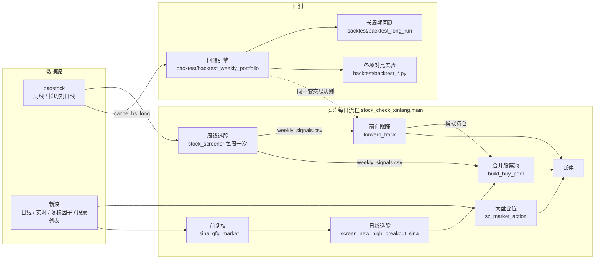

# stock 项目交接文档

> 策略规则本身见 [策略说明.md](策略说明.md)（实盘规则以它为准）。本文讲：项目做了什么、代码怎么组织、怎么运行和部署、做过哪些研究。
>
> 更新：2026-11-04

## 一、项目做什么

一套 **A 股突破选股 + 大盘择时** 的半自动交易辅助系统。策略来自公众号博主「一戈168」，在他的规则基础上用长周期回测逐项验证、调整。

每个交易日收盘后，服务器自动：
1. 按深证综指判断**明天的目标仓位**（0% / 40% / 70% / 100%）；
2. 选出**明天可买的股票**并排好顺序（周线信号 + 日线信号合并池）；
3. 按实盘规则**模拟账户**（前向跟踪），算出每只持仓明天的止损价；
4. 发邮件「操作建议」。

人工根据邮件在券商端下单（集合竞价买卖、网格、条件单）。程序不连券商、不自动下单。

## 二、整体结构



**关键设计**：实盘的大盘判断（`_sz_market_states`）和回测（`market_levels_v2`）逐日对齐（2189 天 0 差异）；前向跟踪直接调用回测引擎的 `run_portfolio`，所以"回测怎么做 = 模拟账户怎么做 = 邮件让你怎么做"。

## 三、文件说明

### 3.1 实盘（每天在跑）

| 文件 | 作用 | 关键函数 / 常量 |
|---|---|---|
| `stock_check_xinlang.py` | **实盘主入口**。`python stock_check_xinlang.py main` | `main()` 每日流程；`sz_market_action` / `_sz_market_states` 大盘；`_sina_load_market` 拉全市场日线；`_sina_qfq_market` 前复权；`screen_new_high_breakout_sina` / `_check_breakout_sina` 日线选股；`build_buy_pool` 股票池；`run_weekly_screener_if_needed` 周线调度；`_wait_sina_daily_ready` 等新浪数据；`send_mail_advice` 邮件；`qfq_init` 首次拉复权因子。常量：`MARKET_INDEX`、`FIRST_LV` / `STRONG_UP_*`、`OPEN_GAP_MAX`、`SHARES_GAP`、`POOL_CAPITAL` |
| `stock_screener.py` | 周线选股（baostock）。信号写入 `stock_result/weekly_signals.csv` | `CFG` 参数表；`check_buy_point_1/2`；`process_one`；`save_weekly_signals`；`BS_USE_PROXY`（本地走代理） |
| `forward_track.py` | 前向跟踪：从 `START = 2026-11-03` 起按实盘规则模拟 80 万账户，输出持仓操作和收益 | `main(market, market_qfq)`；`START` / `CAPITAL` / `PRIORITY` / `REAL` |
| `proxy_bs.py` | baostock 用的 3 个 SOCKS5 代理账密（**不提交 git**） | `PROXIES` |

### 3.2 回测引擎

> 所有回测脚本都在 **`stock/backtest/`** 目录（2026-11-05 从根目录移入）。**在 `stock/` 下运行** `python backtest/backtest_xxx.py`（脚本里的 `cache_bs_long/`、`stock_result/` 都是相对 `stock/` 的路径）。
> 引擎开头会把 `stock/` 加进 `sys.path`（要 import `stock_screener`、`stock_check_xinlang`）；`forward_track.py` 反过来把 `backtest/` 加进 `sys.path` 来 import 引擎——**实盘依赖这个目录，别删别改名**。

| 文件 | 作用 |
|---|---|
| `backtest/backtest_weekly_portfolio.py` | **核心引擎**。数据加载 `load_stock` / `load_daily` / `stock_codes`；周线信号提取 `signals_for_stock` / `extract_signals`；大盘仓位 `market_levels_v2`（参数：`top_mode`、`confirm_rule`、`weak_line`、`first_lv`、`strong`、`top_reduce`）；排名字段 `rank_tables` / `fill_rank_cols` / `add_rank_fields`；组合模拟 `run_portfolio`（参数：`use_freeze`、`priority`、`pool_mode`、`real`、`hold_rule`、`rank_daily`、`grid_atr`、`grid_geo`、`front_sig`/`front_days`（前置池）、`weak_mode`、`freeze_mkt`、`buy_day_stop`、`buy_day_exempt`/`exempt_day2`、`min_step`、`friday`、`weak_days`（走弱判断天数，默认 `WEAK_DAYS`=3））；排序方式表 `PRIORITIES`；实盘约束默认值 `REAL_DEFAULT` |
| `backtest/backtest_daily_portfolio.py` | 日线信号提取（调用实盘同一个 `_check_breakout_sina`），参数 `min_consec` / `max_consec` / `max_gain_2d` |
| `backtest/backtest_long_run.py` | **长周期回测入口**：实盘方案 + 对照组，结果写 `stock_result/long_*.csv`。策略文档里的回测数字来自这里 |

### 3.3 对比实验脚本（每个回答一个问题，可重复跑）

| 脚本 | 问题 | 结论 |
|---|---|---|
| `backtest/backtest_weekly_params.py` | 周线参数用 PDF 原版还是现在调低的？周线票要不要"每天收盘都在突破价上"才留池？ | 现参数好得多（年化 21.6% vs 13.8%）；留池看前日收盘即可 |
| `backtest/backtest_priority.py` | 股票池怎么排序（RPS / 10 日涨幅 / 辨识度分档 / 混合 / 周线优先）？ | RPS120 高→低最好，同分 10 日弱→强 |
| `backtest/backtest_rank_refresh.py` | 周线票的排名每天重算还是固定用周五？ | 差别是噪声，统一用周五 |
| `backtest/backtest_bottom_confirm.py` | 底分型确认条件要不要加严（最高收盘 / 突破最高价 / 实体顶部）？ | 都更差，维持"收盘 ≥ 第 3 根收盘" |
| `backtest/backtest_first_level.py` | 首日建几层？大涨日要不要多建？ | 首日一律 4 层最好；指数涨 > 3% 时 7 层更好（已采用） |
| `backtest/backtest_gain2d.py` | 日线"近 2 日涨幅 < 20%"要不要放宽？ | 不放宽 |
| `backtest/backtest_daily_conditions.py` | 日线 6 个条件哪些可删、还能加什么？ | 6 条都有用，新增条件无稳定改善 |
| `backtest/backtest_daily_like_weekly.py [spike]` | 日线参考周线条件逐条加（股价/换手/市值、5日涨幅<30%、连红、辨识度、首日涨幅≥5%/倍量≥1.6、MA20、第2日量能），spike=辨识度阈值稳健性 | 都不加：硬过滤/首日倍量/第2日量能明显更差；只有辨识度≥15% 合并池 26.3%（基准 25.7%），但 10/12/18/20% 都 25.5~25.8%，且主要来自 2019 年，属偶然 |
| `backtest/backtest_freeze_days.py` | 止损/走弱卖出资金冻结：不冻结 / 冻结1~4天+每周一全解冻 / 冻结到下周一(实盘) / 次日冻结、第3天看次日深证综指收涨且收红才解冻否则冻到下周一（引擎 freeze_mon / freeze_rule="mkt"） | 实盘最好 25.8%；不冻结 11.1%、冻1天 14.2%、冻2天 14.8%、冻3天 24.9%/−13.3%（24-26 只 35.2%）、冻4天=实盘、综指规则 17.8%/−23.7%；维持冻结到下周一 |
| `backtest/backtest_loosen.py wk/dy/combo` | 日线 6 条 / 新高窗口 / 连续天数、周线 CFG 14 项 + 加买点3，逐项放宽扩大池子；combo=日线近2日涨幅阈值稳健性 + 周线过热上限组合 | 只有日线近2日涨幅放宽有效：特征近似 <40% 29.6%/−14.8%；**按实盘函数精确回测 28.7%/−17.3%（基准 25.8%/−15.6%），回撤变差，日线单独 8.1%→5.7%**；<30% 为 26.7%/−15.7%（夏普 1.56，日线单独 5.4%），作为求稳备选；用户 11-08 决定实盘用 40%；周线只有过热 30%→35/40% 年化略高但回撤 −17.6%、18-24 变差，不改；其余放宽持平或更差 |
| `backtest/backtest_gain_nd.py` | 日线涨幅上限改用近3日 / 近4日（20%~60% 各档）对比近2日 20%/40%，用实盘选股函数的不限涨幅信号事后过滤 | 近3/4日卡得紧（≤45%）合并池 17~25%，明显差；≥50% 基本不过滤，≈近2日<40%（28~29.5%、回撤 −17%）；日线单独全部不如近2日<20%（8.1%）；不用近3/4日 |
| `backtest/backtest_open_gap.py` | 开盘涨幅 > 5/6/7(实盘)/8/9/10% 不买、不限（只跳过开盘涨停），日线近2日<40% 口径 | 合并池 5~8% 都在 28.7~29.6%（6% 最高 29.6%/−17.3%，8% 回撤最小 −16.6%），≥9% 和不限变差；周线单独 7% 最好；差别在噪声内；用户 11-08 决定改 6%（backtest_long_run REAL 同步改 0.06） |
| `backtest/backtest_ma_n.py` | 大盘 10 日线换成 6/7/8/9/12 日线（引擎 market_levels_v2 ma_n，分型等其余不变） | 10 日线最好 29.6%/−17.3%；8 日线 23.5%/−18.1%、9 日线 23.2%、12 日线 26.5%、6/7 日线 11.8/13.5%（回撤 −28~−31%）；维持 10 日线 |
| `backtest/backtest_gain_2d5d.py` | 日线近2日<30%/40%(实盘) × 近5日涨幅 不限/<30/40/50/60%（开盘>6% 口径） | 实盘 29.6%/−17.3%；2日<30% 27.0%/−16.0%；加5日<30~50% 17~24.5%，明显差；5日<60% 29.0%/−16.2%（夏普 1.69）与实盘持平，但 50% 就掉到 24.5%，处在悬崖边、不稳；不加5日上限 |
| `backtest/backtest_open_gap_board.py` | 开盘涨幅上限按板块 max(6%, 涨跌停幅度×50/60/70%)（主板 6/6/7%，创业板/科创板 10/12/14%）对比统一 6%(实盘)/7%（引擎 max_open_gap 可传函数） | 合并池 28.9/28.4/27.4% vs 实盘 29.6%，都不更好（×50% 回撤 −16.7% 略好）；创业板/科创板放宽到 10%+ 多买的几笔不赚钱；维持统一 6% |
| `backtest/backtest_top_confirm_k.py` | 顶分型确认加容差：次日收盘 ≤ 第3根收盘×k 才清仓，k=1(实盘)/0.999/0.998/0.997/0.995/0.993/0.99（`market_levels_v2(top_k=)`） | 合并池 29.6(实盘)/28.9/29.1/29.8/27.6/26.5/24.1%，0.997 只高 0.2 点且回撤 −17.3→−17.6%、日线单独变差，0.995 起回撤跳到 −23.3%；对 k 很敏感，不稳健，维持 k=1 |
| `backtest/backtest_top_wait.py` | 顶分型清仓后：确认日之后连续 N=1~5 天收盘在10日线上（没突破顶点）也按10日线规则开仓 40%（`market_levels_v2(top_wait=)`） | 合并池 25.4/26.8/29.1/28.7/29.6% vs 实盘 29.6%；N=2 少 2.8 点、2020/2023/2025 各少 7~13 点，日线单独回撤 −20.9→−26.5%；N=5 起与实盘一致（没有清仓后连续5天在线上又没突破顶点的情况）；维持必须突破顶点 |
| `backtest/backtest_top_bottom.py` | 顶分型确认日同时出现底分型：照常清仓(实盘) / 顶分型作废 / 再看1天（收盘<确认日收盘才清）/ 再看1天（收盘<底分型中间K最低才清）（`market_levels_v2(top_bottom=None/cancel/defer/defer_low)`） | 合并池 29.6/29.8/30.2/30.5%，回撤 −17.3→−16.8%，周线单独 15.0→16.3/16.4%，日线单独 6.3→6.2/5.9%；2018 年来只有 9 次（其中 4 次次日收盘破中间K最低、照样清仓，只晚一天），样本很小；另测 defer_body（收盘<中间K实体最低 min(开,收) 才清）30.2%/−16.8%，9 次里决定和 defer 完全相同（比最低价线多清 2018-11-07、2019-05-31、2022-11-18 三次）；**11-09 已上线 defer_low**（`TOP_BOTTOM_DEFER`，回测 MKT_KW 已带 top_bottom="defer_low"） |
| `backtest/backtest_bottom_any.py` | 顶分型清仓后 10日线上的底分型也算、次日确认就开仓不用突破顶点：只算确认日当天的 / 加上等顶点期间的（`market_levels_v2(bottom_any=topday/all)`） | 合并池 29.6(实盘)/29.8/28.4%，回撤都 −17.3%；topday 2018 年来只触发 1 次（2021-10-22，开仓 2 天又跌破10日线清），差异是路径噪音；all 更差；不改 |
| `backtest/backtest_stop_line.py` | 盘中清仓价：实盘 max(昨MA5,昨最低)×0.99 / 昨收<MA5 时只用最低 / 昨收<MA5 时用下方最近 MA10/20/30 / 始终用下方最近 MA5~30（`run_portfolio(stop_rule=)`，`bw.stop_line`） | 合并池 30.5(实盘)/30.1/29.1/28.9%，回撤 −16.8/−17.2/−17.1/−17.6%；周线单独 16.4→14.6/15.0/14.7%；止损笔数 1075→959~1001 但多拿的票不赚钱；维持实盘 |
| `backtest/backtest_dd_control.py` | 回撤控制（合并池，单变量）：每天最多新开 2/3/5 只、买入日失败熔断（近 5/10 日 ≥K 笔停开）、净值回撤 ≥6~12% 降到 3/5/7 层、本周止损/走弱 ≥3/5/8 笔停开；`stop` 参数：开盘 ≤ 止损价×1.00~1.03 不买（`run_portfolio(max_new_day/brk/dd_cap/week_stop/skip_below_stop)`） | 全部更差，而且多数回撤反而更大：最好的「净值回撤≥8%降到7层」30.2%/−18.3%，「开盘≤止损价不买」20.6%/−17.6%，熔断 −1~16%。原因：大回撤主要来自新开仓的买入日止损/走弱（震荡、风格不对时反复试错），但这些试错的钱冻结到周一本身就在自动降仓，回撤后的反弹也是靠继续开仓抓到的，限制开仓会错过反弹；维持实盘 |
| `backtest/backtest_breadth_nh.py` / `backtest_breadth_nh_rev.py` | 全市场新高股次日表现择时（合并池，单变量）：昨日收盘创 100 日新高的股票（非 ST），今天 收盘/昨收(cc) 或 收盘/开盘(oc) 的近 3/5/10/20 日加权均值；低于阈值不开新仓或开仓上限 3/5/7 层（mkt `open_cap` 列）；rev=高于阈值不开 | 两个方向都更差：正向最好「cc 近10日<−1% 不开」30.4%/−16.9%（只拦 4% 天数，约等于没改），拦得多的收益大降、回撤更大；反向「cc 近10日>0.5% 不开」回撤 −11.9% 但年化 19.9%。2021、2025-12 两次大回撤期间该指标反而高于平均，拦不住；维持实盘 |
| `backtest/backtest_open_free.py` | 本周第 1 / 第 2 / 第 1+2 个交易日开盘卖出（顺延卖 + 开盘止损）的资金不冻结、当天可用（`run_portfolio(open_free={0}/{1}/{0,1})`） | 都更差：周一 30.3%/−17.8%，周二 25.0%/−16.1%，周一+周二 24.4%/−17.7%；维持冻结到下周一 |
| `backtest/backtest_top_up.py` | 可开额度 = 开仓上限 − 冻结 − 持仓（层），额度 > 0.1/0.2/0.3/0.5/0.7 层就向上取整开（1.25 层开 2 只），现金不够一层用冻结资金补足（`run_portfolio(top_up=x)`） | 都更差：0.1 层 25.3%/−17.2%，0.5 层 27.1%/−15.7%（最好，回撤略小但年化少 3.4 个点），0.7 层 27.2%/−18.0%；多出的约 400 笔大多是弱势周补开、平均收益低，2019、2022 掉得最多；维持实盘 |
| `backtest/backtest_entry_nofreeze.py` | 空仓→开仓且开仓日/次日满仓的波段，从开仓日起 3~7 个交易日内取消冻结（已冻结的解冻、卖出不冻结）；对照：所有空仓→开仓（`run_portfolio(free_mask=...)`） | 全部大幅更差：3 天 22.8%/−24.1%，5 天 21.6%/−30.1%，7 天 21.3%/−27.6%；空仓→开仓共 177 次（133 次次日满仓），覆盖 20~46% 交易日，开仓初期的失败票占比高，不冻结后反复补开把亏损放大（2020、2022 掉得最多）；维持实盘 |
| `backtest/backtest_ztdt_nofreeze.py` | A. 前一日涨停 > 50 且 跌停/涨停 < 0.05~0.3 → 当日不冻结；B. 空仓→开仓且首日 70%、次日满仓（共 8 次）→ 开仓日起 3~7 天不冻结（`free_mask`；每日涨跌停数存 stock_result/zt_dt_daily.csv） | A 全部大幅更差：<0.05 20.7%/−20.8%，<0.3 6.9%/−45.4%（满足条件的日子多、多在震荡市，失败票反复补开）。B 小幅更好：5 天 31.6%/−16.8%，6 天 32.6%/−16.9%，但只有 8 次、提升主要来自 2026 年（4-09、6-16 两次），18-24 段基本持平，样本小。**已上线 6 天**（2026-11-11 起，`STRONG_NOFREEZE_DAYS=6` / `STRONG_NOFREEZE_FROM`；引擎 `market_levels_v2(strong_nofreeze=6)` 输出 `no_freeze` 列，`run_portfolio` 自动读取；`backtest_long_run.MKT_KW` 已含；**11-11 修正成交口径**：开盘卖出（不冻结 / 大盘清仓顺延）的钱改为次日开盘才可用（赶不上同一场集合竞价），重测原规则 30.5% 不变、6 天 30.9%（不是 32.6%），3/4/5/7 天 30.8/31.3/31.7/32.1%，8/9/10/11/12/15/20 天 32.4/30.5/30.6/30.6/30.6/29.5/29.3%（20 天回撤 −20.9%），4~8 天都不差于原规则、9 天起回落，单次行情影响大；基准变为 30.9% / −16.9%；forward_track 按切换日只对 11-11 起生效，邮件「最多新开」行会提示窗口内不冻结） |
| `backtest/backtest_up2_nofreeze.py` | 空仓→开仓且信号日深证综指涨 > 2% 并收在 10 日线上（36 次，含 >3% 的 8 次），开仓日起 3~10 天不冻结；另加「次日满仓」条件（34 次）；开盘卖出的钱次日可用 | 全部更差：3 天 28.2%/−22.4%，6 天 27.8%/−21.9%，10 天 24.7%/−22.3%（原规则 30.5%/−16.8%，实盘 70% 6 天 30.9%）；加不加次日满仓结果一样。涨 2%~3% 的那 28 次开仓失败率高，不冻结后反复补开，2021 年 −2.8% → −9%~−11%；维持实盘只对 >3%（首日 70%）生效 |
| `backtest/backtest_up2_nofreeze.py 2.5,3` | 同上，涨幅门槛 2.5%（20 次）/ 3%（8 次，= 实盘规则，结果与实盘一致作校验），3~10 天 | 2.5%：3/4/5/6/7/8/9/10 天 30.5/30.0/32.7/31.3/31.8/31.4/29.4/28.8%，回撤都 −16.8%~−17.0%；6~8 天平台 31.3~31.8%，且 18-24 段 22.8~23.3%（原规则 22.1%，3% 门槛的提升只在 24-26 段），按年 2022 +8~13 个点、2025 −3~−17 个点。比 3%/6 天（30.9%）略好、更稳。**11-11 已上线 2.5% + 7 天**（替换当天定的 3%/6 天，`STRONG_NOFREEZE_DAYS=7`、`STRONG_NOFREEZE_UP=0.025`、`STRONG_NOFREEZE_FROM=2026-11-11`；引擎 `strong_nofreeze_mask(level, close, n, up)` / `market_levels_v2(strong_nofreeze=(7, 0.025))`；基准 31.8% / −16.8%，周线单独 14.7%、日线单独 6.5%） |
| `backtest/backtest_strong_lv.py` | 首日 70% 的涨幅门槛 3.5/3/2.5/2%（不冻结 2.5%+7 天不变），带「只限站上 10 日线」对照，另测首日直接 100%（`market_levels_v2(strong=(thr, lv[, "ma"]))`） | 3.5% 31.1%（4 次）、**3%（实盘）31.8%（8 次）、2.5% 33.1%（20 次）**、2% 32.2%（37 次），回撤都 −16.7%~−16.8%；2.5% 两段都提升（18-24 23.3→24.2、24-26 57.1→59.4）、夏普 1.73→1.78；只限站上 10 日线结果相同（涨 >2.5% 的开仓基本都在 10 日线上）；首日 100% 更差（2.5% 31.3%、3% 30.7%）。**11-11 已上线 2.5%**（`STRONG_UP_PCT=0.025`，`backtest_long_run.MKT_KW strong=(0.025, 0.7)`；基准 33.1% / −16.8%，周线单独 16.9%、日线单独 6.6%） |
| `backtest/backtest_bj.py` | 加入北交所有没有用？ | 几乎无影响略差，不加 |
| `backtest/backtest_bottom_breakout.py` | 空→开仓头几天把"底部倍量突破"票放在股票池前面？（参数 `narrow` / `brk` 跑窄窗口、突破天数变体） | 底部票平均每笔 ≈0 或亏、胜率 ~40%，都不如基线；不采用 |
| `backtest/backtest_weak_rule.py` | 新开票走弱：首日弱次日开盘卖 / 次日尾盘卖 / 只看次日 / 两天都弱 / 不判断 | 现规则（首日弱→次日开盘卖）最好 |
| `backtest/backtest_buy_day_stop.py` | 买入当天触及止损算不算（on/off/开盘在止损价下不算）；参数 `exempt`：当天涨幅 > 3~7% 时首日止损/走弱（及次日走弱）不卖 | 现规则最好；涨>4% 豁免年化 22.8~23.3%、回撤加深约 2 点，不采用 |
| `backtest/backtest_min_step.py` | 股票池过滤网格步长 < 3/4/5/6% 的票；看收益和股票池够不够（买不满天数、缺口层数） | 3% 几乎无影响（极少票步长 <3%），4% 起变差，6% 明显变差；不过滤 |
| `backtest/backtest_weekly_cfg.py` | 周线参数 bp1_vol_ratio 1.6→1.5、warm_max 1.5→1.8、confirm_gain_max 0.15→0.20、min_price 3→2、市值 20→10、上市周数 40→26（全改 / 只改买点1 / 只改过滤） | 都更差：全改合并池 23.6%→15.8%、回撤 −28.8%；只改买点1 17.5%；只改过滤 20.8%（24-26 更好但 18-24 大幅变差）；维持旧参数 |
| `backtest/backtest_friday.py` | 周五开新仓：不开（实盘）/ 正常开 / 只开日线票 | 合并池正常开 24.9% / −18.0%（vs 23.6% / −19.4%），18-24 更好、24-26 更差（42.3 vs 49.7）；**11-05 采用（周五正常开）** |
| `backtest/backtest_weak_days.py` | 尾盘走弱判断覆盖前 2 / 3 / 4 / 5 天 / 全程 | 前 3 天 25.8% / −15.6%（vs 前 2 天 24.9% / −18.0%）；**11-05 采用（前 3 天）** |
| `backtest/backtest_grid_parts.py` | 网格 3/4/5 份 × 步长 1.0/1.2 倍 ATR | 合并池 4份×1.2 25.8%/−15.6%（实盘）；4份×1.0 25.8%/−16.4%；3份、5份都更差；维持 |
| `backtest/backtest_grid_round.py` | 网格每份股数取整：向下（2600→600×3+800）/ 向上（700×3+500）/ 四舍五入（引擎 `GRID_ROUND`） | 25.8 / 25.7 / 25.2%，差别在噪声内；维持向下取整 |
| `backtest/backtest_open_down.py` | 新开票开盘跌停 / 跌 >9% / >8% / >7% 跳过、顺延买下一只（引擎 `open_down`） | 合并池 25.8（不跳过）/ 24.3 / 23.9 / 23.8 / 23.1%，越跳越差；维持不跳过 |
| `backtest/backtest_tail_clear.py` | 大盘清仓信号当天尾盘清（可卖的尾盘卖、当天买的次日开盘）：只跌破10日线 / 所有清仓信号（`market_levels_v2(tail_clear=)`） | 合并池 25.8（次日开盘）/ 25.7 / 25.6%，回撤都 −15.6%；8 年只涉及 33~50 笔，无差别；维持次日开盘清 |
| `backtest/backtest_watch_ma.py` | 跌破10日线但未破8日线（对照5日线）→ 次日不清不开新仓观察，收盘没回10日线上则尾盘清（`market_levels_v2(watch_ma=)`） | 8 年只触发 9 天；合并池 25.8（实盘）/ 25.5 / 24.8%，回撤 −15.6 / −16.6 / −16.5%；更差，维持 |
| `backtest/backtest_weak_cond.py` | 走弱判断条件：创新高且收涨（实盘）/ 满足一项即可 / 只看收涨 / 只看创新高（引擎 `weak_cond`） | 合并池 25.8 / 22.1 / 24.9 / 23.2%，回撤 −15.6 / −18.2 / −18.7 / −16.6%；放宽都更差，维持两项都要满足 |
| `backtest/backtest_top_fractal.py` | 顶分型：确认日不开新仓 / 中间K须近10/20/60日最高 / 开仓满3/5天才看（`market_levels_v2(top_no_new / top_need_high / top_min_days)`） | 合并池 25.8（实盘）/ 22.3 / 22.0 / 20.0 / 17.4 / 23.3 / 21.2%；全部更差，底部附近的顶分型也要认；维持 |
| `backtest/backtest_mon_open.py` | 上周触发、周一开盘卖出的资金：冻结到下周一（实盘）/ 周一当天可用 / 周二起可用 / 周一所有开盘卖出当天可用（引擎 `mon_open`） | 合并池 25.8 / 25.1 / 24.5 / 25.5%，回撤 −15.6 / −16.3 / −16.7 / −16.3%；放开都更差（日线单独略好），维持冻结 |
| `backtest/backtest_capital_layers.py [份数,…]` | 本金 80/100/130/160/200 万 × 分 8/10/12/15 份（合并池，引擎份数改由 `LAYER` 控制：可开层数 = 仓位 / LAYER） | 8 份 23.8~24.4% / −17%；10 份 25.2~25.8% / −15.5~−15.9%；12 份 ≈20% / −17~−18%；15 份 ≈16% / −21%。本金基本不影响（整手误差 ±0.6%），份数越多越差，维持 10 份 |
| `backtest/backtest_top_reduce.py` | 顶分型确认当天尾盘降到 7/5/4/3/0 层（文章做法）；大盘清仓资金冻结到周一 | 降仓都更差；尾盘清 ≈ 次日开盘清；冻结略差；维持现规则 |

### 3.4 数据拉取

| 文件 | 作用 |
|---|---|
| `fetch_daily_long_bs.py` | 拉 baostock 2018 起前复权日线到 `cache_bs_long/`（3 个代理各一进程、单连接、断点续跑，全量约 2.5 小时） |
| `fetch_bj_eastmoney.py` | 拉北交所日线（东方财富）到 `cache_bs_long/bj_*.pkl`，只给 `backtest/backtest_bj.py` 用 |

### 3.5 其他（早期 / 辅助，不在实盘流程里）

| 文件 | 作用 |
|---|---|
| `stock_check_dongcai.py` | 东方财富接口的单票检查（早期版本） |
| `stock_screener_history.py` | 周线选股的早期版本 |
| `stock_img.py` | 把一串股票代码生成图片 |

## 四、数据与输出

**缓存目录（都不提交 git，不要手动清）**

| 目录 | 内容 |
|---|---|
| `cache/` | `stock_screener` 的周线 / 日线缓存（baostock）。**清掉会导致周线选股重拉很久** |
| `cache_sina/` | 新浪日线 `kline_sina_*.pkl`、股票列表、复权因子 `qfq_*.pkl`、复权覆盖日 `qfq_checked.txt` |
| `cache_bs_long/` | 回测数据：baostock 前复权日线 `s[hz]_*.pkl`、深证综指 `sz_399106.pkl`、深证成指 `sz_399001.pkl`、北交所 `bj_*.pkl`；信号缓存 `_weekly_signals*.pkl`、`_daily_breakout_signals*.pkl`、`_daily_features.pkl` |
| `cache_sina_long/` | 早期新浪长周期日线（已不用） |

**输出 `stock_result/`（csv 都不提交 git）**

| 文件 | 来源 | 内容 |
|---|---|---|
| `pool_{日期}.csv` | 每日 | 下一交易日股票池（邮件附件） |
| `forward_holdings_{日期}.csv` | 每日 | 模拟持仓和明日操作（邮件附件） |
| `forward_equity.csv` / `forward_trades.csv` | 每日 | 模拟账户每日资产、已平仓交易 |
| `forward_track.MANUAL_SKIP` | 实盘手动跳过时加一行 | (日期, 代码, 原因)：模拟当天不买这只、顺延下一只（引擎 `skip_buy`），让模拟和实盘一致；写在代码里随 git 同步到服务器 |
| `历史清仓个股.xlsx` | 每日（有新清仓时） | `forward_track.update_history`：按（代码, 买入日）去重，旧行不改只追加；邮件附件 |
| `result_sina_{时间}.csv` | 每日 | 日线选股结果 |
| `weekly_signals.csv` | 每周 | 周线信号历史（**服务器上的是唯一来源，别删**） |
| `weekly_run_info.json` | 每周 | `stock_screener.main` 写：运行时间、周线数据日期、命中数、无数据/拉取失败代码、结果文件名；每周最后一个交易日的邮件据此附上 `result_{时间}.csv` 并在正文标明日期（`stock_check_xinlang.weekly_screener_mail_part`） |
| `actual_account.csv` | 手填 | 实际账户 `日期,总资产`，前向跟踪会对比 |
| `long_*.csv`、`*_summary.csv`、`*.log` | 回测 | 各次回测结果 |

## 五、运行与部署

### 5.1 环境

- Python：`~/venv/python3-forcrawl`（服务器 `/home/pi/venv/python3-forcrawl`），依赖 pandas、numpy、requests、chinese_calendar、baostock、yagmail、PySocks。
- 本地 / 服务器靠主机名区分：含 `houjie-` 的是本地 → baostock 走代理、**不发邮件**；服务器直连、发邮件。

### 5.2 服务器

| 项 | 值 |
|---|---|
| 登录 | `ssh pi@db.selfmediaai.cn -p8522`（主机名 pi5） |
| 代码 | `/home/pi/work/claude_code/stock`（git pull 更新） |
| 日志 | `/home/pi/logs/stock_daily.log` |
| crontab 备份 | `~/work/crontab_backup_20261103.txt` |

crontab：
```
30 15 * * 1-4 cd /home/pi/work/claude_code/stock && /home/pi/venv/python3-forcrawl/bin/python stock_check_xinlang.py main >> /home/pi/logs/stock_daily.log 2>&1
0 19 * * 5 （同上）
```
- 周一~四 15:30：新浪数据约 15:30~15:36 才更新，程序会自动等（最多 90 分钟）。
- 周五 19:00：baostock 17:30 后才有本周周线，会顺带跑周线选股。

### 5.3 常用命令（都在 `stock/` 下）

| 场景 | 命令 |
|---|---|
| 每日实盘（手动补跑） | `python stock_check_xinlang.py main`（收盘后 15:40 后再跑） |
| 新机器首次部署 | 先 `python stock_check_xinlang.py qfq_init`（全量复权因子约 1 小时；也可从别的机器拷 `cache_sina/qfq_*.pkl` + `qfq_checked.txt`，保留文件时间） |
| 只看大盘 | `python -c "import stock_check_xinlang as s; s.sz_market_action()"` |
| 单独跑前向跟踪 | `python forward_track.py` |
| 手动跑周线选股 | `python stock_screener.py`（周五 17:30 后） |
| 长周期回测 | `python backtest/backtest_long_run.py > stock_result/long_run.log 2>&1`（信号有缓存时约 5 分钟） |
| 更新回测数据 | `python fetch_daily_long_bs.py`（先删要更新的 `cache_bs_long/s[hz]_*.pkl`，更新后删信号缓存） |

### 5.4 改策略的流程

1. 用回测验证：在 `backtest/` 下写或改一个 `backtest_*.py` 对比脚本，只改一个变量，看**合并池和单独池、2018~2024 和 2024~2026 两段**是否同向改善。
2. 改实盘代码（`stock_check_xinlang.py` 的大盘 / 选股 / 股票池；涉及交易规则的同时改 `backtest/backtest_weekly_portfolio.py`，前向跟踪自动跟上）。
3. 大盘规则改动后，核对 `_sz_market_states` 和 `market_levels_v2` 逐日一致。
4. 同步 `backtest/backtest_long_run.py` 的实盘方案，重跑，更新 [策略说明.md](策略说明.md) 的规则、回测数字和变更记录。
5. 服务器 `git pull`。

## 六、注意事项（踩过的坑）

| 事项 | 说明 |
|---|---|
| **baostock 禁止并发** | 多进程并发会被按 IP 拉黑（错误 10001011）。本机 IP 已被拉黑，所以本地走 `proxy_bs.py` 代理；所有请求单连接串行。2026-11-07 代理 20081 端口也被拉黑：`_ensure_login` 登录失败（拉黑/网络错误）会自动换下一条线路（本地：代理1→2→3→直连；服务器：直连→代理），`_bs_route_i` 记住本次用的线路 |
| **baostock 长时间运行断连** | 服务器首次全量拉周线要 2 小时多，2026-11-06 跑到第 4892 只时连接断开（Connection reset / Broken pipe / 接收数据异常），之后 138 只周线和几乎全部 RPS 日线都没拉到（池子 RPS 用新浪，不受影响）。已改：`_bs_query` 统一重试（失败后重新 login 建新连接，等 2/5/15/30s），连续 20 只失败暂停请求；网络失败不再算"无新数据"；扫完后 `_retry_failed` 最多补拉 3 轮；`_weekly_date_check` 打印周线日期分布、落后和无缓存的票。漏拉了就手动 `python stock_screener.py`，有缓存的直接跳过、只补缺的 |
| **不要清缓存** | `cache/` 周线缓存重建很慢；`cache_sina/` 有完整性检查，不用手动清 |
| **新浪数据更新晚** | 个股约 15:30、指数约 15:36 才出当天日 K；15:10 前一律按前一交易日算 |
| **新浪限流** | 股票列表分页偶尔返回空页，已改成按总数校验、不完整不缓存；复权因子拉取并发高了会被断开 |
| **复权** | 新浪日 K 不复权；全市场用复权因子转前复权，只在除权时重拉（每日检测 + 漏跑补齐 + 周五兜底） |
| **T+1** | 早期回测没考虑 T+1，结论完全反了。所有回测都必须开 T+1 |
| **pickle 版本** | 本地 pandas 1.4、服务器 2.2，缓存可以互相读；但用系统 python3 写的 pickle 会读不出来，统一用 venv 的 python |
| **邮件** | 发件账号密码写死在 `send_mail_advice` 里（用户选择）；本地不发 |
| **git** | `stock_result/*.csv`、缓存目录、`proxy_bs.py` 都在 `.gitignore` 里 |

## 七、研究记录（时间顺序）

| 日期 | 做了什么 | 结论 |
|---|---|---|
| 11 月初 | 日线选股加字段（突破日涨幅、近 2 日涨幅、昨日是否新高、连续新高天数）、加 K 线形态过滤 | 现日线 6 条件 |
| 11 月初 | 回测日线首日 / 第二日买入、网格参数、周线组合（大盘择时、冻结、优先级） | 网格 1.2 × ATR 分 4 份；止损资金冻结到周一 |
| 11-02 | **加入 T+1** | 日线首日突破方案从 17% 掉到 3.7%，周线方案反而变好；改为只做连续 ≥ 2 日新高 |
| 11-02 | 周线 + 日线合并池、买点3、开盘涨幅上限（4~7%）、实盘约束（整手、滑点、费率） | 合并池最好；不要买点3；开盘 > 7% 不买 |
| 11-03 | 大盘指数深证成指 → 深证综指 | 年化 +3 个点 |
| 11-03 | 上线：服务器定时、邮件、前向跟踪、股票池 csv | — |
| 11-03 | 周线参数 PDF 原版 vs 现版；周线留池规则 | 维持现状 |
| 11-04 | 5 种排序 + 同分规则；周线排名取值日 | RPS120 + 同分 10 日弱→强；固定周五 |
| 11-04 | 底分型确认 5 种写法 | 维持现规则 |
| 11-04 | 回测 vs 实盘口径逐项核对 → 实盘改前复权、排除北交所 | 已改 |
| 11-04 | 北交所、近 2 日涨幅上限、日线条件逐项 | 都维持现状 |
| 11-04 | 首日仓位 4~10 层；大涨日 7 层 | 采用"涨 > 3% 建 70%" |
| 11-04 | 网格步长用信号日 vs 买入前一日的 ATR | 几乎无差别，统一用买入前一日 |
| 11-04 | 网格按价格（等差）vs 按比例（复利） | 按价格 23.6% vs 22.6%，用按价格 |
| 11-05 | 空→开仓窗口用底部倍量突破池（窗口 1~7 天、强势开仓、突破 10~60 日、各参数） | 不采用（底部票套现有止损/网格不赚钱） |
| 11-05 | 新开票走弱的 5 种执行方式 | 维持：首日弱→次日开盘卖，次日弱→尾盘卖 |
| 11-05 | 买入当天止损：不检测 / 开盘在止损价下方不算 / 当天涨幅>3~7% 豁免止损和走弱 | 都不如现规则（买入当天触及止损或走弱 → 次日开盘卖） |
| 11-05 | 周线参数放宽（倍量 1.5、温和放量 1.8、W2 涨幅 0.20、价格 2、市值 10 亿、上市 26 周） | 全部更差，维持旧参数 |
| 11-05 | 周五也开新仓 | 全期略好（两段方向相反：18-24 +4、24-26 −7），用户决定采用；引擎 `friday` 默认改为 all |
| 11-05 | 走弱判断天数：前 2 / 3 / 4 / 5 天 / 全程 | 合并池 24.9 / 25.8 / 26.2 / 25.9 / 26.0%，回撤 −18.0 / −15.6 / −15.7 / −15.8 / −15.8%；4 天后几乎无变化；采用前 3 天（回撤最低、24-26 不变） |
| 11-05 | 网格 3/4/5 份 × 1.0/1.2 倍 ATR | 4份×1.2 最好（25.8% / −15.6%）；平均每笔只卖 0.3 份网格，网格参数影响小；维持 |
| 11-06 | 新开票开盘大跌（跌停 / >9% / >8% / >7%）跳过顺延；持仓开盘 ≤ 止损价按开盘价清仓（引擎早已如此） | 跳过全部更差（23.1~24.3% vs 25.8%），维持开盘照买 |
| 11-06 | 大盘清仓信号当天尾盘清 vs 次日开盘清 | 无差别（25.6~25.7% vs 25.8%），维持次日开盘清 |
| 11-06 | 跌破10日线但未破8日线（或5日线）先观察一天 | 更差（25.5% / −16.6%），维持跌破即次日开盘清 |
| 11-06 | 走弱条件放宽（或 / 只看收涨 / 只看创新高） | 都更差，维持"创新高且收涨"才不算弱 |
| 11-06 | 顶分型过滤（只认顶部 / 开仓满 N 天）、确认日不开新仓 | 全部更差（17.4~23.3% vs 25.8%）；任何位置的顶分型都处理、确认日照常开仓 |
| 11-07 | 本金 80~200 万 × 分 8/10/12/15 份 | 本金几乎不影响；8 份 ≈24% / −17%（24-26 年 48% 更好、18-24 年 16% 更差），12 份 ≈20%，15 份 ≈16%（10 份 25.8%），维持 10 份 |
| 11-07 | 日线选股参考周线条件（17 项 + 辨识度阈值 5 档） | 无稳定改善，日线维持现行 6 条 |
| 11-08 | 卖出资金冻结天数（0~4 天+周一解冻、综指涨红解冻） | 都不如冻结到下周一，维持实盘 |
| 11-08 | 日线/周线选股条件逐项放宽（扩大池子） | **已上线**：日线近2日涨幅 <20%→<40%，按信号日切换（MAX_GAIN_2D_FROM=2026-11-06，之前信号仍 20%，前向跟踪历史买卖不变）；其余不改 |
| 11-08 | 日线涨幅上限改近3日 / 近4日 | 都不如近2日，不改 |
| 11-08 | 开盘涨幅 > 5~10% 不买 | **已上线 6%**（用户决定；按买入日切换 OPEN_GAP_FROM=2026-11-09，之前买入仍 7%）；1 层参考股数改前收×1.03 |
| 11-08 | 大盘 10 日线改 6/7/8/9/12 日线 | 都更差，维持 10 日线 |
| 11-08 | 日线加近5日涨幅上限 30~60% | 不加，维持近2日<40% |
| 11-09 | 开盘涨幅上限按板块（创/科放宽） | 不如统一 6%，不改 |
| 11-09 | 顶分型确认加容差（次日小跌不算确认） | 0.997 仅 +0.2 点、回撤略差，0.995 起明显变差，不改 |
| 11-09 | 顶分型清仓后连续 N 天守住10日线就开仓 | 都不如必须突破顶点，不改 |
| 11-09 | 顶分型确认日遇底分型先不清仓、再看一天 | 合并池 +0.6~0.9 点、回撤略好，只有 9 次样本；**已上线**（次日收盘破底分型中间K最低才清，无日期切换） |
| 11-09 | 顶分型清仓后线上底分型确认也开仓 | 只触发 1 次 / 更差，不改 |
| 11-09 | 昨收在5日线下时止损价改用最低/下方最近均线 | 都更差，维持 max(MA5,最低)×0.99 |
| 11-10 | 几次大回撤归因 + 5 类回撤控制参数（限开仓数/熔断/净值降仓/周止损停开/开盘破止损不买） | 都更差，不改 |
| 11-05 | 过滤网格步长 < 3~6% 的票 | 不过滤（3% ≈ 不变，≥4% 变差、池子更不够） |
| 11-05 | 对照"一戈168 风控体系"文章：顶分型尾盘降仓 7/5/4/3/0 层、大盘清仓资金冻结 | 降仓 18.4~20.1%（降仓后留仓等突破期间亏钱）；尾盘清 23.4% ≈ 现 23.6%；冻结 23.2%；维持现规则 |
